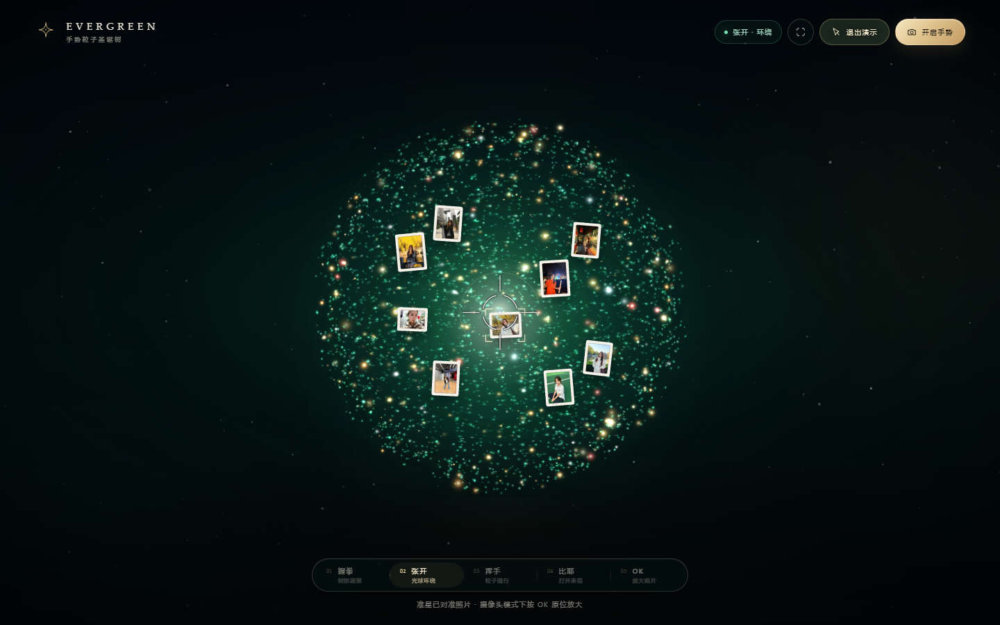
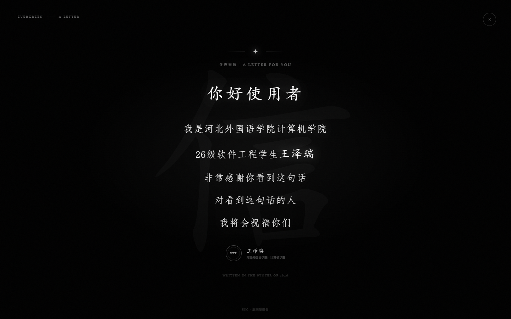

# EVERGREEN · 手势粒子圣诞树

一棵会回应掌心的粒子圣诞树。

- **初始状态**：完整的圣诞树。
- **握拳**：重新凝聚为完整的树。
- **张开手掌**：所有粒子组成一颗持续环绕的 3D 光球，九张照片贴在光球正面，始终面向你。
- **左右挥动**：整个光球跟随掌心移动，照片不随球体自转；球体旋转和跟手速度都更快。
- **OK 手势**：掌心出现十字准星，准星指向哪张照片，就在原位放大哪张；松开 OK 后恢复。
- **比耶**：切换进黑底白字来信，自我介绍逐字出现；结尾“天天开心期末必过”另起一页，四周环绕白色颗粒。
- **没有摄像头**：内置鼠标/触屏演示模式，可以挥动光球与照片；键盘按 `O` 也可预览来信。
- **摄像头启动失败**：页面自动切换到演示模式，同时左下角保留一个「摄像头未启动」卡片——可以直接在那里换设备、重试，或运行 `camera-doctor.bat` 诊断。

## 预览








## 启动

建议使用 Windows 自带的 Edge 或 Chrome。

1. 双击 `start-server.bat`。
2. 浏览器会自动打开本地页面（默认 `http://127.0.0.1:8000/`）。
3. 点击右上角 **开启手势**，允许摄像头。
4. 把手掌放进左下角 HAND CAM 画面内：握拳聚树、张开成球、左右挥动跟随。
5. 保持手掌张开，让所有粒子聚成光球；移动掌心，把十字准星对准一张照片，比一个 **OK**，照片会在准星处放大。
6. 松开 OK 恢复光球；**比耶**并保持约半秒，会切换到给你的来信。

> 来信开始后会关闭摄像头，画面只在本机处理。按 `Esc` 或右上角 × 可以返回圣诞树。没有摄像头时，直接按 `O` 也能预览这封来信。
>
> 摄像头必须在 `localhost` 或 HTTPS 页面中使用。不要直接双击 `index.html`，否则浏览器可能拒绝摄像头。

如果双击批处理没有反应，也可以在本目录手动执行：

```bash
python serve.py
```

然后访问终端里打印的本地地址。

## 首次载入

手势引擎（MediaPipe Tasks Vision）的 WebAssembly 和模型都在 `vendor/` 内，启动时从本机读取，首次初始化通常需要约 1–5 秒。之后再次打开会快很多。

## 操作提示

- 保持手掌完整、光线充足、背景尽量简单，识别会更稳定。
- 手指完全张开时触发“散开”；四指收拢成拳时触发“凝聚”。
- 张开手掌状态下左右移动，光球与照片会跟着手走。
- 光球会持续自转，速度比普通漂浮更快；手掌移动时整个球体会快速跟随。
- **OK**：拇指和食指围成小圈，其余三指伸展。十字准星跟着掌心移动，准星指向的照片会在原位放大；松开 OK 恢复。
- **比耶**：食指和中指伸展分开，无名指和小指握起，保持约半秒打开来信。
- 右上角的 **演示** 不调用摄像头：按住鼠标/手指 = 张开手掌，左右移动 = 挥手，松开 = 握拳。照片互动只能在摄像头手势模式下放大。
- **全屏** 按钮进入沉浸模式。
- 来信页按 `Esc` 或右上角关闭按钮返回；页尾也提供“回到圣诞树”按钮。
- 在来信播放中的任意时刻都可以按 `Esc` 退出。页面打字速度约为每字 0.08 秒，完整播放约需 12–15 秒。

## 九张照片

九张照片位于 `photos/photo-1.jpg` 到 `photo-9.jpg`。它们会被画成带白色相框的小卡片，集中在光球正面。

- 照片只在树散开时出现。
- 照片跟随光球整体移动，但不参与球体自转，始终正面朝向你。
- 掌心会出现十字准星；准星对准某张照片时，照片四角会出现提示框。
- 保持 OK 时，准星当前指向的照片会在原位放大；照片不会移动到页面中央。
- 想换一张照片：松开 OK，移动手掌把准星移到另一张照片上，再比 OK。
- 想换成别的照片：直接替换 `photos/` 下的同名文件即可。

## 文件结构

```
christmas-tree-hand/
├── index.html                 单页应用（界面、粒子与照片动画、手势逻辑）
├── start-server.bat           一键启动本地服务器并打开浏览器
├── serve.py                   零依赖本地静态服务器
├── camera-doctor.bat          摄像头一键诊断（双击运行）
├── camera-doctor.ps1          诊断脚本本体；加 -Fix 可重置摄像头设备（需管理员）
├── README.md
├── preview-*.png              效果预览图
├── photos/
│   ├── photo-1.jpg            九张照片（带白色相框显示在光球正面）
│   ├── photo-2.jpg
│   ├── photo-3.jpg
│   ├── photo-4.jpg
│   ├── photo-5.jpg
│   ├── photo-6.jpg
│   ├── photo-7.jpg
│   ├── photo-8.jpg
│   └── photo-9.jpg
└── vendor/
    ├── vision_bundle.js       MediaPipe Tasks Vision 运行时
    ├── hand_landmarker.task   MediaPipe 手部关键点模型
    └── wasm/
        ├── vision_wasm_internal.js
        └── vision_wasm_internal.wasm
```

`vendor/` 和 `photos/` 都是页面的一部分，复制或移动页面时请一起保留。照片只在本机读取和绘制，不会上传。

## 常见问题

**点击「开启手势」后提示“本地手势组件缺失”**  
请确认 `vendor/` 与 `index.html` 在同一目录，且文件没有被杀毒软件隔离。

**页面显示“当前页面无法使用摄像头”**  
请通过 `start-server.bat` / `serve.py` 打开，不要使用 `file://`。

**提示“摄像头无法启动 / 设备被占用”（NotReadableError）**  
窗口左下角会保留一个「摄像头未启动」卡片，可以直接在那里：

1. 先关闭可能占用摄像头的程序：微信视频、ToDesk 远程摄像头、腾讯会议、Zoom、OBS 等，以及其他浏览器标签里的摄像头。
2. 华硕笔记本确认键盘 **F10** 的摄像头开关已打开（指示灯亮）。
3. 点卡片里的 **重试**；有多个摄像头时，可以在下拉框换一台再点重试。
4. 还不行就双击运行 `camera-doctor.bat`，按提示检查；确认摄像头没坏的前提下，用管理员运行
   `camera-doctor.ps1 -Fix` 重置一次摄像头设备。

摄像头打开成功后被别的程序抢走时（比如同事远程要看你的摄像头），同样会出现这个错误，重试即可。

**手势识别不灵敏**  
让手掌离镜头近一些、正对镜头，避免逆光；并确认整个手掌都在镜头内。少数浏览器/系统摄像头驱动会限制分辨率，可重新插拔摄像头后重试。

## 技术说明

- 纯原生 HTML/CSS/JavaScript，无框架。
- 手部 21 个关键点由 MediaPipe Tasks Vision 在本机 WebAssembly 中推理。
- 手势分类、3D 光球粒子投影、照片卡片绘制均为本项目内的原生 Canvas 2D 实现。
- 照片以带白色相框的小卡片绘制在独立 Canvas 上，固定在光球正面，不随球体旋转；掌心准星决定放大哪一张。
- 比耶来信使用原生 DOM/CSS 排版和 Canvas 粒子；文字逐字展开，祝福页另起一页。
- 来信全文（含祝福页）：
  > 你好使用者我是河北外国语学院计算机学院26级软件工程学生王泽瑞非常感谢你看到这句话对看到这句话的人我将会祝福你们天天开心期末必过
- MediaPipe 采用 Apache-2.0 许可。详见 <https://github.com/google-ai-edge/mediapipe>。
