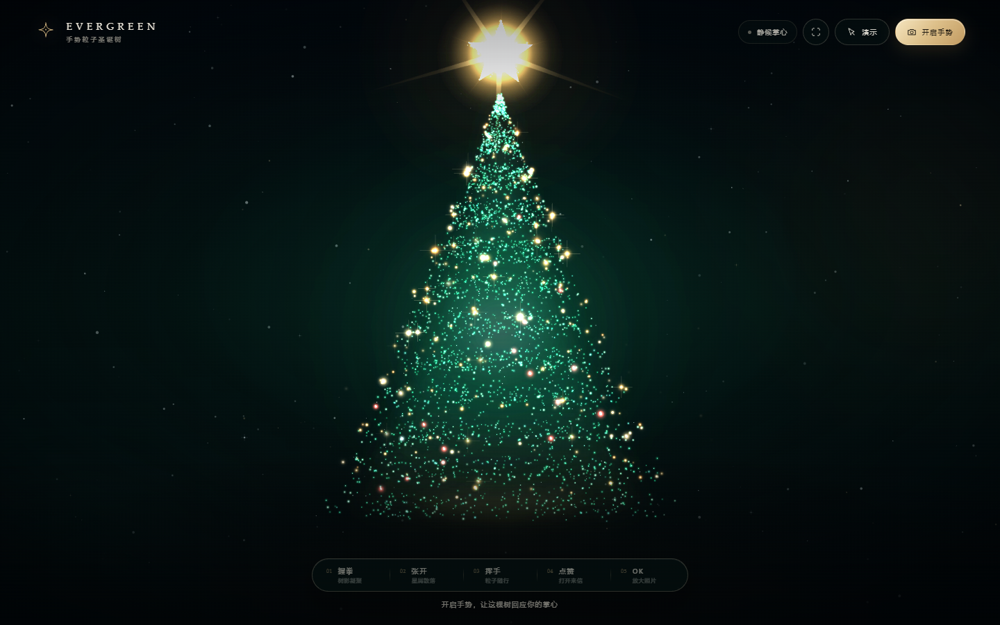
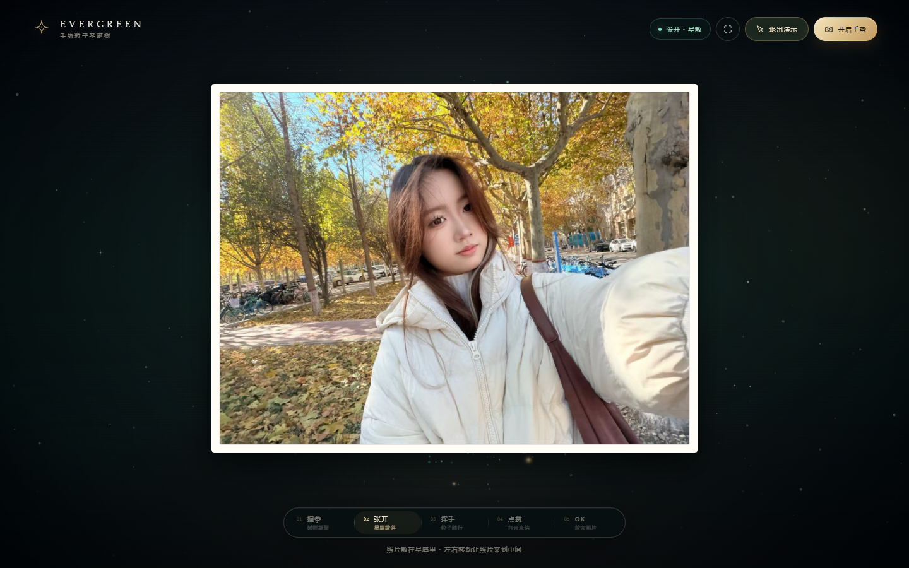
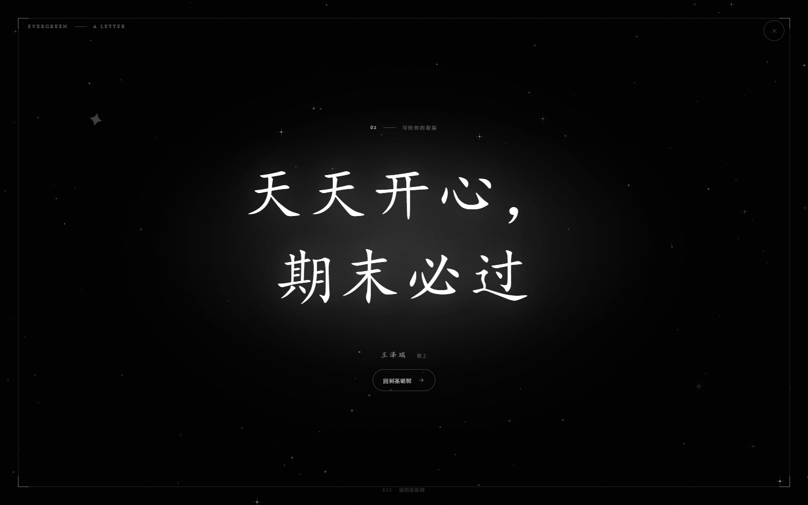

# EVERGREEN · 手势粒子圣诞树

一棵会回应掌心的粒子圣诞树。

- **初始状态**：完整的圣诞树。
- **握拳**：重新凝聚为完整的树。
- **张开手掌**：树化为一颗颗粒子星云，五张白色相框照片散落在星屑之间。
- **左右挥动**：粒子与照片一起追随掌心移动，照片会轻轻漂浮。
- **OK 手势**：只在照片来到画面中间时放大这一张；松开 OK 后回到星屑中。
- **竖起大拇指**：切换进黑底白字来信，自我介绍逐字出现；结尾“天天开心，期末必过”另起一页，四周环绕白色颗粒。
- **没有摄像头**：内置鼠标/触屏演示模式，可以挥动照片星云；键盘按 `O` 也可预览来信。

## 预览









## 启动

建议使用 Windows 自带的 Edge 或 Chrome。

1. 双击 `start-server.bat`。
2. 浏览器会自动打开本地页面（默认 `http://127.0.0.1:8000/`）。
3. 点击右上角 **开启手势**，允许摄像头。
4. 把手掌放进左下角 HAND CAM 画面内：握拳聚树、张开星散、左右挥动跟随。
5. 保持手掌张开，让照片散开；移动掌心把一张照片送到画面中间，比一个 **OK**，照片会放大。
6. 松开 OK 恢复星屑；**竖起大拇指**并保持约半秒，会切换到给你的来信。

> 来信开始后会关闭摄像头，画面只在本机处理。按 `Esc` 或右上角 × 可以返回圣诞树。没有摄像头时，直接按 `O` 也能预览这封来信。
>
> 摄像头必须在 `localhost` 或 HTTPS 页面中使用。不要直接双击 `index.html`，否则浏览器可能拒绝摄像头。

如果双击批处理没有反应，也可以在本目录手动执行：

```bash
python serve.py
```

然后访问终端里打印的本地地址。

## 首次载入

手势引擎（MediaPipe Tasks Vision）的 WebAssembly 和模型都在 `vendor/` 内，启动时从本机读取，首次初始化通常需要约 1–5 秒。之后再次打开会快很多。

## 操作提示

- 保持手掌完整、光线充足、背景尽量简单，识别会更稳定。
- 手指完全张开时触发“散开”；四指收拢成拳时触发“凝聚”。
- 张开手掌状态下左右移动，粒子与照片会跟着手走。
- **OK**：拇指和食指围成小圈，其余三指伸展。之前那一张在画面中间的照片会被放大；没有照片居中时，画面中央会出现一个很淡的取景圈。
- **点赞**：竖起大拇指，其余四指握起，保持约半秒打开来信。
- 右上角的 **演示** 不调用摄像头：按住鼠标/手指 = 张开手掌，左右移动 = 挥手，松开 = 握拳。照片互动只能在摄像头手势模式下放大。
- **全屏** 按钮进入沉浸模式。
- 来信页按 `Esc` 或右上角关闭按钮返回；页尾也提供“回到圣诞树”按钮。
- 在来信播放中的任意时刻都可以按 `Esc` 退出。页面打字速度约为每字 0.08 秒，完整播放约需 12–15 秒。

## 五张照片

五张照片位于 `photos/photo-1.jpg` 到 `photo-5.jpg`。它们会被画成带白色相框的卡片，加入散开的星屑中。

- 照片只在树散开时出现。
- 照片会随掌心左右移动，并缓慢上下漂浮。
- OK 手势会锁定离画面中心最近、且在中央取景圈内的照片。照片被放大后会暂时移到画面中央，松开 OK 再回到原本的星屑位置。
- 想换一张照片：松开 OK，移动手掌让另一张照片来到中间，再比 OK。
- 想换成别的照片：直接替换 `photos/` 下的同名文件即可。

## 文件结构

```
christmas-tree-hand/
├── index.html                 单页应用（界面、粒子与照片动画、手势逻辑）
├── start-server.bat           一键启动本地服务器并打开浏览器
├── serve.py                   零依赖本地静态服务器
├── README.md
├── preview-*.png              效果预览图
├── photos/
│   ├── photo-1.jpg            五张照片（带白色相框显示在星云中）
│   ├── photo-2.jpg
│   ├── photo-3.jpg
│   ├── photo-4.jpg
│   └── photo-5.jpg
└── vendor/
    ├── vision_bundle.js       MediaPipe Tasks Vision 运行时
    ├── hand_landmarker.task   MediaPipe 手部关键点模型
    └── wasm/
        ├── vision_wasm_internal.js
        └── vision_wasm_internal.wasm
```

`vendor/` 和 `photos/` 都是页面的一部分，复制或移动页面时请一起保留。照片只在本机读取和绘制，不会上传。

## 常见问题

**点击「开启手势」后提示“本地手势组件缺失”**  
请确认 `vendor/` 与 `index.html` 在同一目录，且文件没有被杀毒软件隔离。

**页面显示“当前页面无法使用摄像头”**  
请通过 `start-server.bat` / `serve.py` 打开，不要使用 `file://`。

**手势识别不灵敏**  
让手掌离镜头近一些、正对镜头，避免逆光；并确认整个手掌都在镜头内。少数浏览器/系统摄像头驱动会限制分辨率，可重新插拔摄像头后重试。

## 技术说明

- 纯原生 HTML/CSS/JavaScript，无框架。
- 手部 21 个关键点由 MediaPipe Tasks Vision 在本机 WebAssembly 中推理。
- 手势分类、星云粒子物理、照片卡片绘制均为本项目内的原生 Canvas 2D 实现。
- 照片以带白色相框的卡片绘制在独立 Canvas 上，随掌心移动，并用缓慢的漂浮与取景圈规则决定放大对象。
- 点赞来信使用原生 DOM/CSS 排版和 Canvas 粒子；文字逐字展开，祝福页另起一页。
- 来信全文（含祝福页）：
  > 你好，使用者我是河北外国语学院计算机学院26级软件工程学生王泽瑞，非常感谢你看到这句话，对看到这句话的人我将会祝福你们，天天开心，期末必过
- MediaPipe 采用 Apache-2.0 许可。详见 <https://github.com/google-ai-edge/mediapipe>。
